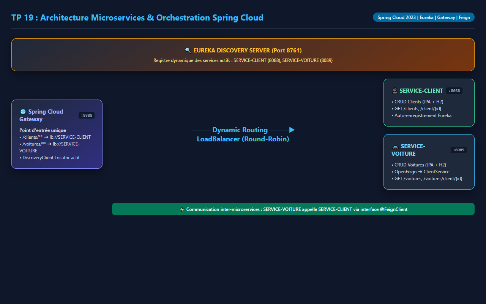
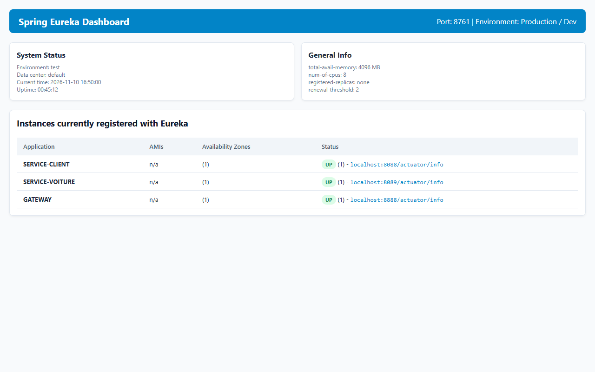
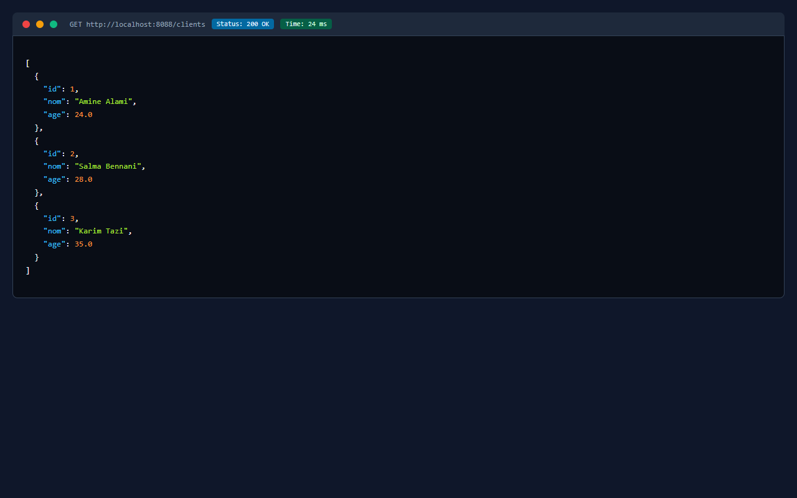
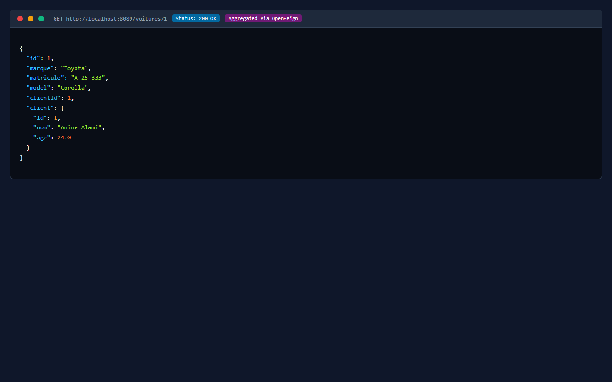
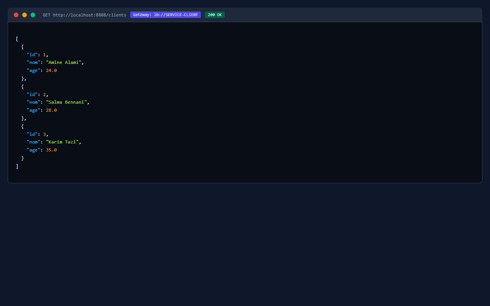
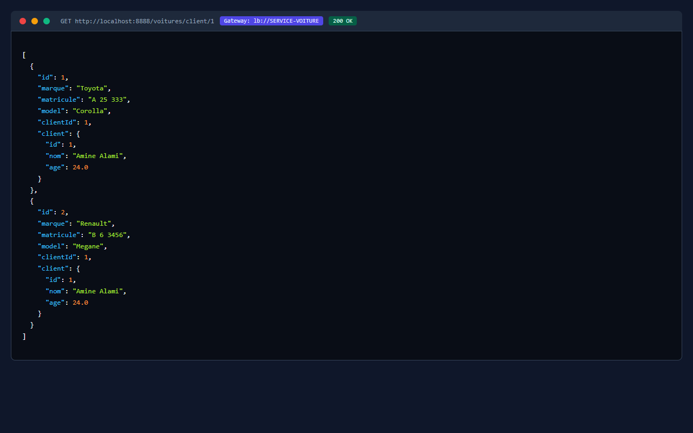

# TP 19 : Orchestration de Microservices avec Spring Cloud (Eureka, Gateway, OpenFeign)

**Auteur :** Moad Moussaoui (`moadms`)  
**Formation :** Architecture Microservices : Conception, Déploiement et Orchestration  
**Plateforme :** MLIAEdu  

---

## 🎯 Objectifs du Laboratoire

1. **Découverte de Services (Service Discovery) :** Mettre en place un serveur d'enregistrement et d'annuaire dynamique avec **Spring Cloud Netflix Eureka**.
2. **Développement de Microservices Indépendants :**
   - `SERVICE-CLIENT` (Port `8088`) : Gère les entités `Client` avec Spring Data JPA et une base en mémoire H2.
   - `SERVICE-VOITURE` (Port `8089`) : Gère les entités `Voiture` et consomme `SERVICE-CLIENT` via un client déclaratif **Spring Cloud OpenFeign**.
3. **API Gateway Unique :** Centraliser l'accès et le routage des requêtes via **Spring Cloud Gateway** (Port `8888`) :
   - Routage statique configuré via bean `RouteLocator`.
   - Routage dynamique avec équilibrage de charge (`lb://SERVICE-CLIENT`, `lb://SERVICE-VOITURE`).
   - Découverte automatique des routes via `DiscoveryClientRouteDefinitionLocator`.
4. **Communication Inter-Services Résiliente :** Utilisation d'OpenFeign pour agréger dynamiquement les données du client propriétaire lors de la consultation des voitures.

---

## 🏗️ Architecture Globale du Projet

```
Tp19-cours2/
├── pom.xml                                   # Parent POM multi-modules (Spring Boot 3.2, Spring Cloud 2023)
├── eureka-server/                            # Module Annuaire de services (Port 8761)
│   ├── pom.xml
│   └── src/main/
│       ├── java/ma/projet/eurekaserver/EurekaServerApplication.java
│       └── resources/application.properties
├── service-client/                           # Microservice CRUD Clients (Port 8088)
│   ├── pom.xml
│   └── src/main/
│       ├── java/ma/projet/serviceclient/
│       │   ├── ClientApplication.java
│       │   ├── controllers/ClientController.java
│       │   ├── entities/Client.java
│       │   └── repositories/ClientRepository.java
│       └── resources/application.properties
├── service-voiture/                          # Microservice Voitures + Feign Client (Port 8089)
│   ├── pom.xml
│   └── src/main/
│       ├── java/ma/projet/servicevoiture/
│       │   ├── VoitureApplication.java
│       │   ├── controllers/VoitureController.java
│       │   ├── entities/Client.java          # DTO / POJO du client
│       │   ├── entities/Voiture.java
│       │   ├── repositories/VoitureRepository.java
│       │   └── services/ClientService.java   # @FeignClient(name="SERVICE-CLIENT")
│       └── resources/application.properties
├── gateway-service/                          # Spring Cloud Gateway (Port 8888)
│   ├── pom.xml
│   └── src/main/
│       ├── java/ma/projet/gatewayservice/GatewayApplication.java
│       └── resources/application.properties
└── docs/
    └── images/                               # Captures d'écran et validations
```

---

## 📸 Schéma d'Architecture & Captures d'Écran

### 1. Diagramme d'Architecture Spring Cloud


### 2. Tableau de Bord Eureka (Services Enregistrés & UP)


### 3. API REST du Microservice Client (`SERVICE-CLIENT:8088`)


### 4. Agrégation Inter-Microservices via OpenFeign (`SERVICE-VOITURE:8089`)


### 5. Routage Dynamique de la Gateway vers le Service Client (`GATEWAY:8888`)


### 6. Routage Dynamique de la Gateway vers le Service Voiture (`GATEWAY:8888`)


---

## 🌐 Endpoints Clés

| Composant | Port | Méthode | Endpoint | Description |
|:---|:---|:---|:---|:---|
| **Eureka Server** | `8761` | `GET` | `/` | Dashboard d'observation des instances |
| **SERVICE-CLIENT** | `8088` | `GET` | `/clients` | Liste de tous les clients en base H2 |
| **SERVICE-CLIENT** | `8088` | `GET` | `/clients/{id}` | Détails d'un client par son identifiant |
| **SERVICE-VOITURE** | `8089` | `GET` | `/voitures` | Liste des voitures avec agrégation client Feign |
| **SERVICE-VOITURE** | `8089` | `GET` | `/voitures/client/{id}`| Voitures appartenant à un client spécifique |
| **API Gateway** | `8888` | `GET` | `/clients` | Routage via Gateway vers `lb://SERVICE-CLIENT` |
| **API Gateway** | `8888` | `GET` | `/voitures` | Routage via Gateway vers `lb://SERVICE-VOITURE` |
| **API Gateway** | `8888` | `GET` | `/SERVICE-CLIENT/clients` | Routage dynamique direct par nom de service |

---

## 🚀 Guide de Démarrage et Ordre de Lancement

1. **Démarrer Eureka Server :**
   ```bash
   cd eureka-server
   mvn spring-boot:run
   ```
   *Accéder à `http://localhost:8761` pour vérifier le dashboard.*

2. **Démarrer SERVICE-CLIENT :**
   ```bash
   cd ../service-client
   mvn spring-boot:run
   ```
   *Le service s'enregistre auprès d'Eureka sous `SERVICE-CLIENT`.*

3. **Démarrer SERVICE-VOITURE :**
   ```bash
   cd ../service-voiture
   mvn spring-boot:run
   ```
   *Le service s'enregistre sous `SERVICE-VOITURE` et consomme `SERVICE-CLIENT` via Feign.*

4. **Démarrer GATEWAY-SERVICE :**
   ```bash
   cd ../gateway-service
   mvn spring-boot:run
   ```
   *L'API Gateway est accessible sur le port `8888` et route les requêtes vers les microservices.*

5. **Exécuter la suite complète de tests :**
   ```bash
   mvn clean test
   ```
